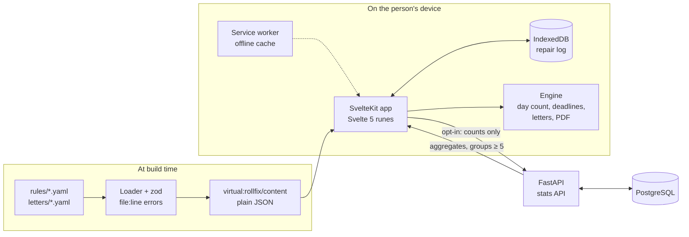

# Architecture

Rollfix is two independent pieces:

1. **The app**: a SvelteKit installable web app, prerendered to static files. It holds the repair
   log on the device, checks it against the state rules, and makes letters and PDFs. It needs no
   server and works offline.
2. **The stats API** (optional): a small FastAPI and PostgreSQL service that stores anonymous
   delay numbers people choose to share, and publishes aggregates for the public dashboard.



## Layout

```
src/
  lib/
    engine/       pure TypeScript, no Svelte: tested in Node with Vitest
      model.ts      repairs, entries, promises, labels
      clock.ts      day counter, promise states, business days
      rules.ts      deadline checks against the timeline
      timeline.ts   the timeline and its plain-language sentences
      letters.ts    letter rendering (values, rule paragraphs, enclosure)
      template.ts   the template language (from Tenantkit)
      civil-date.ts date math on YYYY-MM-DD strings (from Tenantkit)
      holidays.ts   holiday calendars from rules (from Tenantkit)
      schema.ts     zod schemas for the YAML files
    content/      build-time loader and Vite plugin for rules/ and letters/
    pdf/          pdf-lib letter and timeline PDFs (adapted from Tenantkit)
    store/        IndexedDB storage, app state (runes), backups, sample data
    stats/        the anonymous payload and the API client
    components/   Svelte components
  routes/         one prerendered page per screen, plus one per state
  service-worker/ offline cache
rules/ letters/   the content, CC BY 4.0
api/              the stats API (Python)
tests/unit/       Vitest
tests/e2e/        Playwright + axe, run against the built site and the real API
```

## The repair log

A **repair** starts on the day the chair broke (Day 1) and ends on the day it was fixed. It holds
the chair, supplier and insurer details, and a list of **entries**: calls, messages, visits,
approvals, parts, impact notes and so on. An entry can carry a **promise** ("a technician will
come by Tuesday") with a due date; a promise past its date that nobody marked as kept counts as
missed.

The log is stored in IndexedDB (`rollfix` database: a `repairs` store and a `meta` store for the
profile and settings). The app asks the browser for persistent storage after the first save.
Backups are plain JSON; imports are cleaned field by field (`src/lib/store/backup.ts`), so a
damaged or hostile file can't put unexpected data into the app.

`AppState` (`src/lib/store/app.svelte.ts`) is a class with Svelte 5 `$state` fields. Pages read
it directly; every change is written through to IndexedDB. A timer keeps `today` current, so the
counter moves on at midnight without a reload.

## Rules and deadlines

State rules are YAML files with citations ([rules guide](../rules/README.md)). At build time a
Vite plugin (`src/lib/content/vite-plugin.ts`) reads them, validates them with zod and extra
checks (template names, references between files, holiday calendars), and exposes them as the
virtual module `virtual:rollfix/content`. A broken file fails the build with its file and line.
The app receives plain JSON, so zod and the YAML parser never reach the browser.

A **deadline** says what starts the clock (e.g. `reported`), how long it runs (calendar or
business days), and what stops it (e.g. `visit`). `checkDeadline` (`src/lib/engine/rules.ts`)
finds those events on the person's own timeline and returns one of: not started, running, due
today, met, met late, missed, or not in effect (the law wasn't in force yet). Business days skip
weekends and the state's holidays. All date math works on `YYYY-MM-DD` strings converted to day
numbers, so time zones and daylight saving can't shift a deadline.

## Letters

"Write a letter" is one step: everything comes from the log. A letter file supplies the wording;
`renderLetter` supplies the values (dates, day count, missed promises, logged effects) and a
paragraph for every rule that matters to that recipient, each citing the law. The output keeps
values separate from text, so the preview can highlight what came from the log and flag anything
missing. The same structure becomes plain text (copy, `.txt`) or a US-Letter PDF with pdf-lib,
with the full timeline attached as an enclosure. PDFs are made in the browser; pdf-lib is loaded
only when someone downloads one.

## Offline and installable

The service worker (`src/service-worker/index.ts`) caches every built file and prerendered page
when the app is installed. Built files are served cache-first; pages network-first with a cache
fallback (pages like `/repair/?id=…` fall back to the same cached file for any id). Requests to
the stats API are never cached. `static/manifest.webmanifest` makes the app installable, with
maskable icons and shortcuts.

## The stats API

`api/rollfix_api/` is a FastAPI app with an async psycopg pool and a small forward-only migration
runner (SQL files in `migrations/`, guarded by an advisory lock so several instances can start at
once).

| Endpoint                  | What it does                                                    |
| ------------------------- | --------------------------------------------------------------- |
| `POST /v1/reports`        | Store one repair's numbers. Returns an id and a one-time token. |
| `PUT /v1/reports/{id}`    | Replace them (e.g. once the chair is fixed). Needs the token.   |
| `DELETE /v1/reports/{id}` | Remove them for good. Needs the token.                          |
| `GET /v1/stats`           | Aggregates for the dashboard (JSON). Cached briefly.            |
| `GET /v1/stats.csv`       | The same aggregates as CSV.                                     |
| `GET /healthz`, `/readyz` | Liveness and database readiness.                                |
| `GET /v1/version`         | Version, build number and commit.                               |
| `GET /docs`               | OpenAPI documentation.                                          |

**Privacy by design:** reports are validated strictly (fixed categories, bounded numbers, unknown
fields rejected); the finest date is the month the chair broke; rows store creation and update
_dates_, not times; there are no IP addresses or access logs; tokens are stored as SHA-256
hashes; and every aggregate (including the overall median) is withheld until a group has at
least `ROLLFIX_MIN_GROUP_SIZE` (5) reports.

## Accessibility

The people who use Rollfix often use a keyboard, a switch, a screen reader, voice control or
magnification, so this is a design constraint, not a polish step:

- Real links, buttons and form controls only, with visible labels; no icon-only controls, no
  drag and drop, no hover-only content, no time limits.
- At least 48 px targets; whole-row radio and checkbox choices; a strong, high-contrast focus
  ring (including inside date pickers).
- After saving, focus moves to what changed (the new entry, or the counter), and a polite live
  region announces the result. Forms put an error summary first, focused, linking to each field.
- Few steps: quick-add buttons for common entries, letters that fill themselves in.
- High contrast in light and dark mode, Windows High Contrast support, a text size setting, and
  layouts that reflow at 320 px.
- Charts have a text alternative and a table view; colors were checked for contrast in both
  modes.

The Playwright suite runs axe (WCAG 2.2 A/AA plus best practices) on every page, in light and
dark mode and with errors showing, and checks a full keyboard-only journey, visible focus,
target sizes, reflow at 320 px and reduced motion.

## Testing and CI

| Layer        | Tool                         | What                                                    |
| ------------ | ---------------------------- | ------------------------------------------------------- |
| Engine       | Vitest (+ coverage ≥ 85%)    | dates, counter, deadlines, letters, PDF, backups, rules |
| API          | pytest against PostgreSQL    | validation, tokens, rate limits, privacy thresholds     |
| App + API    | Playwright + axe             | real browser, real API, desktop and mobile              |
| Container    | Docker build + smoke test    | image starts, migrates, reports its build               |
| Supply chain | npm audit, pip-audit, CodeQL | on every push; Dependabot weekly                        |

See [RELEASING.md](RELEASING.md) for versions, build numbers and the release pipeline.
